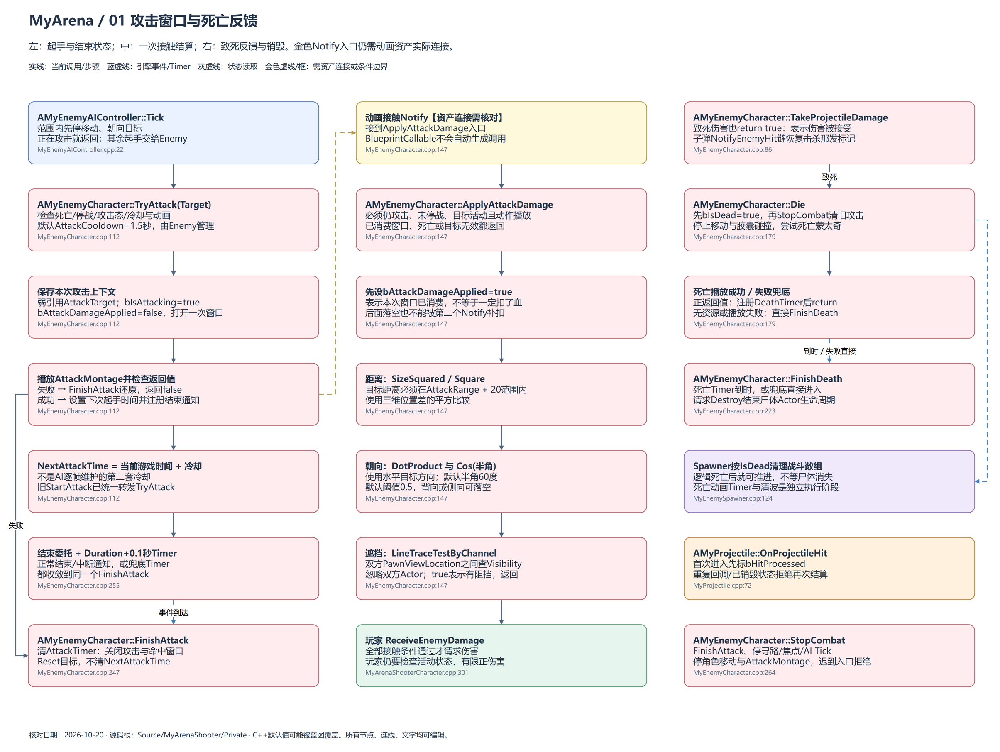
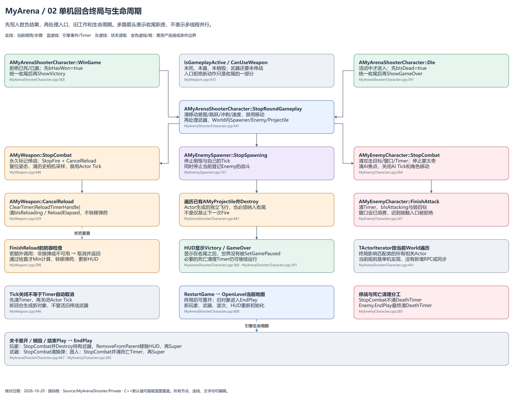
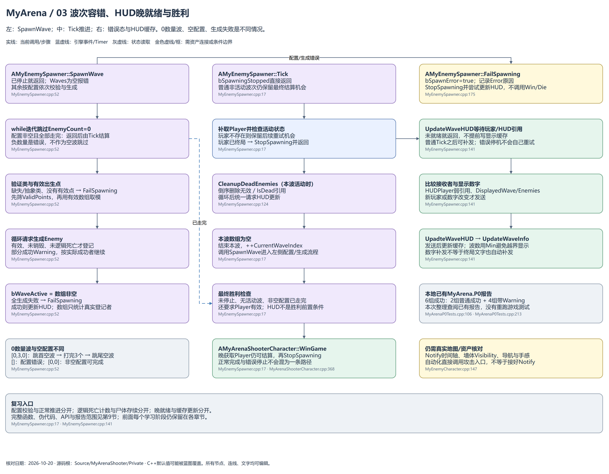

# 基础单机射击版：图纸学习指南

核对日期：2026-10-20。用draw.io打开同目录.drawio原文件，全部节点、文字、连线可编辑。旧图纸按日期保留，不覆盖历史阶段。

## 01 攻击窗口与死亡反馈

## 02 单机回合终局与生命周期

## 03 波次容错、HUD晚就绪与胜利

## 重点与阅读顺序

先读第9节了解终局、容错与验证；再看第7节末尾的新攻击窗口代码，第8节末尾的回弹与摆动接通。第1～6节末尾也记录了本次变化。第1页Notify线表示仍需资产连接，并未把测试中直接调用伤害入口当成时间轴配置证据。第2页多路收尾箭头不代表多线程。第3页HUD补发只涉及数字，胜负文字没有单独的晚就绪重播。

已有报告为2026-10-20 19:31:24的6组MyArena.P0成功记录，本次是查阅与源码核对，没有重新运行。真实地图导航、遮挡配置、动画时间轴和手感还需实际Play核对。

## 当前源码位置

- [MyEnemyAIController.cpp:22](<D:/code/Unreal Projects/MyArenaShooter/MyArenaShooter/Source/MyArenaShooter/Private/MyEnemyAIController.cpp:22>)：`void AMyEnemyAIController::Tick(`
- [MyEnemyCharacter.cpp:112](<D:/code/Unreal Projects/MyArenaShooter/MyArenaShooter/Source/MyArenaShooter/Private/MyEnemyCharacter.cpp:112>)：`bool AMyEnemyCharacter::TryAttack(`
- [MyEnemyCharacter.cpp:255](<D:/code/Unreal Projects/MyArenaShooter/MyArenaShooter/Source/MyArenaShooter/Private/MyEnemyCharacter.cpp:255>)：`void AMyEnemyCharacter::OnAttackMontageEnded(`
- [MyEnemyCharacter.cpp:247](<D:/code/Unreal Projects/MyArenaShooter/MyArenaShooter/Source/MyArenaShooter/Private/MyEnemyCharacter.cpp:247>)：`void AMyEnemyCharacter::FinishAttack(`
- [MyEnemyCharacter.cpp:147](<D:/code/Unreal Projects/MyArenaShooter/MyArenaShooter/Source/MyArenaShooter/Private/MyEnemyCharacter.cpp:147>)：`void AMyEnemyCharacter::ApplyAttackDamage(`
- [MyArenaShooterCharacter.cpp:301](<D:/code/Unreal Projects/MyArenaShooter/MyArenaShooter/Source/MyArenaShooter/Private/MyArenaShooterCharacter.cpp:301>)：`void AMyArenaShooterCharacter::ReceiveEnemyDamage(`
- [MyEnemyCharacter.cpp:86](<D:/code/Unreal Projects/MyArenaShooter/MyArenaShooter/Source/MyArenaShooter/Private/MyEnemyCharacter.cpp:86>)：`bool AMyEnemyCharacter::TakeProjectileDamage(`
- [MyEnemyCharacter.cpp:179](<D:/code/Unreal Projects/MyArenaShooter/MyArenaShooter/Source/MyArenaShooter/Private/MyEnemyCharacter.cpp:179>)：`void AMyEnemyCharacter::Die(`
- [MyEnemyCharacter.cpp:223](<D:/code/Unreal Projects/MyArenaShooter/MyArenaShooter/Source/MyArenaShooter/Private/MyEnemyCharacter.cpp:223>)：`void AMyEnemyCharacter::FinishDeath(`
- [MyEnemySpawner.cpp:124](<D:/code/Unreal Projects/MyArenaShooter/MyArenaShooter/Source/MyArenaShooter/Private/MyEnemySpawner.cpp:124>)：`void AMyEnemySpawner::CleanupDeadEnemies(`
- [MyProjectile.cpp:72](<D:/code/Unreal Projects/MyArenaShooter/MyArenaShooter/Source/MyArenaShooter/Private/MyProjectile.cpp:72>)：`void AMyProjectile::OnProjectileHit(`
- [MyEnemyCharacter.cpp:264](<D:/code/Unreal Projects/MyArenaShooter/MyArenaShooter/Source/MyArenaShooter/Private/MyEnemyCharacter.cpp:264>)：`void AMyEnemyCharacter::StopCombat(`
- [MyArenaShooterCharacter.cpp:368](<D:/code/Unreal Projects/MyArenaShooter/MyArenaShooter/Source/MyArenaShooter/Private/MyArenaShooterCharacter.cpp:368>)：`void AMyArenaShooterCharacter::WinGame(`
- [MyWeapon.cpp:433](<D:/code/Unreal Projects/MyArenaShooter/MyArenaShooter/Source/MyArenaShooter/Private/MyWeapon.cpp:433>)：`bool AMyWeapon::CanUseWeapon(`
- [MyArenaShooterCharacter.cpp:391](<D:/code/Unreal Projects/MyArenaShooter/MyArenaShooter/Source/MyArenaShooter/Private/MyArenaShooterCharacter.cpp:391>)：`void AMyArenaShooterCharacter::Die(`
- [MyArenaShooterCharacter.cpp:441](<D:/code/Unreal Projects/MyArenaShooter/MyArenaShooter/Source/MyArenaShooter/Private/MyArenaShooterCharacter.cpp:441>)：`void AMyArenaShooterCharacter::StopRoundGameplay(`
- [MyWeapon.cpp:446](<D:/code/Unreal Projects/MyArenaShooter/MyArenaShooter/Source/MyArenaShooter/Private/MyWeapon.cpp:446>)：`void AMyWeapon::StopCombat(`
- [MyWeapon.cpp:439](<D:/code/Unreal Projects/MyArenaShooter/MyArenaShooter/Source/MyArenaShooter/Private/MyWeapon.cpp:439>)：`void AMyWeapon::CancelReload(`
- [MyWeapon.cpp:398](<D:/code/Unreal Projects/MyArenaShooter/MyArenaShooter/Source/MyArenaShooter/Private/MyWeapon.cpp:398>)：`void AMyWeapon::FinishReload(`
- [MyEnemySpawner.cpp:161](<D:/code/Unreal Projects/MyArenaShooter/MyArenaShooter/Source/MyArenaShooter/Private/MyEnemySpawner.cpp:161>)：`void AMyEnemySpawner::StopSpawning(`
- [MyArenaShooterCharacter.cpp:408](<D:/code/Unreal Projects/MyArenaShooter/MyArenaShooter/Source/MyArenaShooter/Private/MyArenaShooterCharacter.cpp:408>)：`void AMyArenaShooterCharacter::RestartGame(`
- [MyEnemyCharacter.cpp:285](<D:/code/Unreal Projects/MyArenaShooter/MyArenaShooter/Source/MyArenaShooter/Private/MyEnemyCharacter.cpp:285>)：`void AMyEnemyCharacter::EndPlay(`
- [MyArenaShooterCharacter.cpp:467](<D:/code/Unreal Projects/MyArenaShooter/MyArenaShooter/Source/MyArenaShooter/Private/MyArenaShooterCharacter.cpp:467>)：`void AMyArenaShooterCharacter::EndPlay(`
- [MyEnemySpawner.cpp:52](<D:/code/Unreal Projects/MyArenaShooter/MyArenaShooter/Source/MyArenaShooter/Private/MyEnemySpawner.cpp:52>)：`void AMyEnemySpawner::SpawnWave(`
- [MyEnemySpawner.cpp:17](<D:/code/Unreal Projects/MyArenaShooter/MyArenaShooter/Source/MyArenaShooter/Private/MyEnemySpawner.cpp:17>)：`void AMyEnemySpawner::Tick(`
- [MyEnemySpawner.cpp:175](<D:/code/Unreal Projects/MyArenaShooter/MyArenaShooter/Source/MyArenaShooter/Private/MyEnemySpawner.cpp:175>)：`void AMyEnemySpawner::FailSpawning(`
- [MyEnemySpawner.cpp:141](<D:/code/Unreal Projects/MyArenaShooter/MyArenaShooter/Source/MyArenaShooter/Private/MyEnemySpawner.cpp:141>)：`void AMyEnemySpawner::UpdateWaveHUD(`
- [MyArenaP0Tests.cpp:106](<D:/code/Unreal Projects/MyArenaShooter/MyArenaShooter/Source/MyArenaShooter/Private/Tests/MyArenaP0Tests.cpp:106>)：`IMPLEMENT_SIMPLE_AUTOMATION_TEST(FMyArenaDeathTest,`
- [MyArenaP0Tests.cpp:213](<D:/code/Unreal Projects/MyArenaShooter/MyArenaShooter/Source/MyArenaShooter/Private/Tests/MyArenaP0Tests.cpp:213>)：`IMPLEMENT_SIMPLE_AUTOMATION_TEST(FMyArenaAttackTest,`
