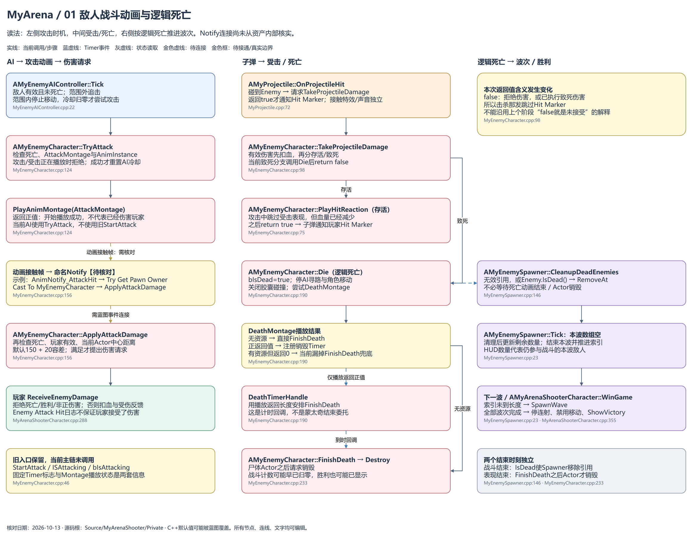
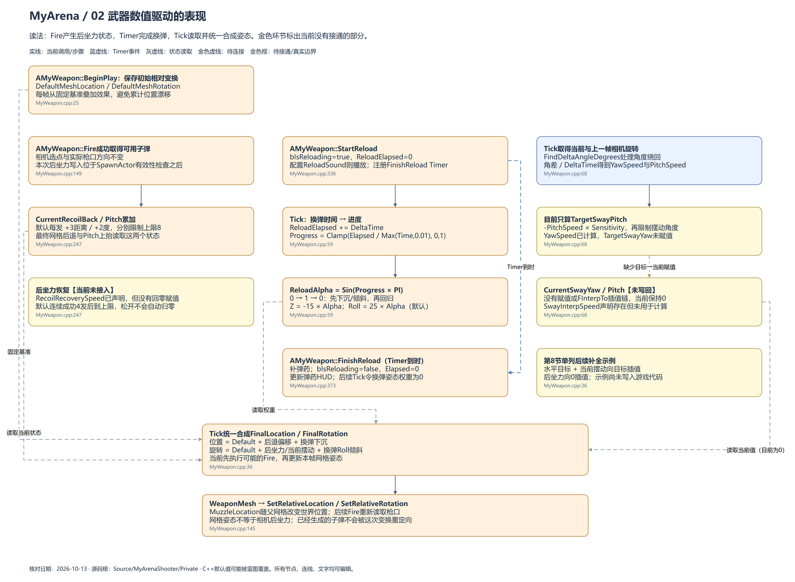

# MyArena：战斗动画与武器表现追加图

核对日期：2026-10-13。以当前C++源码为依据；旧总框架图（2026-10-11）继续保留作为学习阶段。

用draw.io打开同目录原生.drawio文件。全部节点、连线、文字可以编辑，不是把截图装入图纸。实线表示当前调用/步骤，蓝虚线表示引擎调度或Timer事件，灰虚线表示状态读取，金色虚线表示待连接；金色框用于待接通或当前边界。

## 第1页：敌人战斗动画与逻辑死亡

左边读AI决定起手、TryAttack与动画接触时刻；中间读子弹扣血、受击表现、死亡与之后销毁；右边读Spawner按IsDead推进波次。Notify线以需核对的蓝图连接示例表示，不声称资产内部已经接通。

复习时对比三个时刻：开始攻击不等于提出伤害；逻辑死亡不等于Actor已经销毁；完成波次不要求尸体已经消失。注意当前致死伤害return false会跳过Hit Marker，死亡资源存在但播放失败时缺少FinishDeath兜底。

## 第2页：武器数值驱动的表现

先看BeginPlay缓存基准，再看Fire累加后坐力、Timer完成换弹、Tick计算曲线与最终变换。目标和当前状态是不同变量；当前摆动未写回，后坐力也未回零。图中的待完善说明对应第8节示例，不表示已修改游戏实现。

## 相关笔记

第7节《敌人战斗动画与伤害时机》包含完整函数、普通命名Notify连接步骤、蒙太奇与Slot的关系及死亡分支。第8节《武器后坐力、换弹姿态与惯性摆动》包含Tick完整代码、Sin曲线表格、角速度例子和单独标注的补全建议。原有第2～6节末尾追加了2026-10-13学习记录。

## 源码位置

图中标注文件与行号，完整路径如下；同目录索引.json也保存了这些可核对的位置。

- [MyEnemyAIController.cpp:22](<D:/code/Unreal Projects/MyArenaShooter/MyArenaShooter/Source/MyArenaShooter/Private/MyEnemyAIController.cpp:22>)：`void AMyEnemyAIController::Tick(`
- [MyEnemyCharacter.cpp:124](<D:/code/Unreal Projects/MyArenaShooter/MyArenaShooter/Source/MyArenaShooter/Private/MyEnemyCharacter.cpp:124>)：`bool AMyEnemyCharacter::TryAttack(`
- [MyEnemyCharacter.cpp:156](<D:/code/Unreal Projects/MyArenaShooter/MyArenaShooter/Source/MyArenaShooter/Private/MyEnemyCharacter.cpp:156>)：`void AMyEnemyCharacter::ApplyAttackDamage(`
- [MyArenaShooterCharacter.cpp:288](<D:/code/Unreal Projects/MyArenaShooter/MyArenaShooter/Source/MyArenaShooter/Private/MyArenaShooterCharacter.cpp:288>)：`void AMyArenaShooterCharacter::ReceiveEnemyDamage(`
- [MyEnemyCharacter.cpp:46](<D:/code/Unreal Projects/MyArenaShooter/MyArenaShooter/Source/MyArenaShooter/Private/MyEnemyCharacter.cpp:46>)：`void AMyEnemyCharacter::StartAttack(`
- [MyProjectile.cpp:72](<D:/code/Unreal Projects/MyArenaShooter/MyArenaShooter/Source/MyArenaShooter/Private/MyProjectile.cpp:72>)：`void AMyProjectile::OnProjectileHit(`
- [MyEnemyCharacter.cpp:98](<D:/code/Unreal Projects/MyArenaShooter/MyArenaShooter/Source/MyArenaShooter/Private/MyEnemyCharacter.cpp:98>)：`bool AMyEnemyCharacter::TakeProjectileDamage(`
- [MyEnemyCharacter.cpp:75](<D:/code/Unreal Projects/MyArenaShooter/MyArenaShooter/Source/MyArenaShooter/Private/MyEnemyCharacter.cpp:75>)：`void AMyEnemyCharacter::PlayHitReaction(`
- [MyEnemyCharacter.cpp:190](<D:/code/Unreal Projects/MyArenaShooter/MyArenaShooter/Source/MyArenaShooter/Private/MyEnemyCharacter.cpp:190>)：`void AMyEnemyCharacter::Die(`
- [MyEnemyCharacter.cpp:233](<D:/code/Unreal Projects/MyArenaShooter/MyArenaShooter/Source/MyArenaShooter/Private/MyEnemyCharacter.cpp:233>)：`void AMyEnemyCharacter::FinishDeath(`
- [MyEnemySpawner.cpp:146](<D:/code/Unreal Projects/MyArenaShooter/MyArenaShooter/Source/MyArenaShooter/Private/MyEnemySpawner.cpp:146>)：`void AMyEnemySpawner::CleanupDeadEnemies(`
- [MyEnemySpawner.cpp:23](<D:/code/Unreal Projects/MyArenaShooter/MyArenaShooter/Source/MyArenaShooter/Private/MyEnemySpawner.cpp:23>)：`void AMyEnemySpawner::Tick(`
- [MyArenaShooterCharacter.cpp:355](<D:/code/Unreal Projects/MyArenaShooter/MyArenaShooter/Source/MyArenaShooter/Private/MyArenaShooterCharacter.cpp:355>)：`void AMyArenaShooterCharacter::WinGame(`
- [MyWeapon.cpp:25](<D:/code/Unreal Projects/MyArenaShooter/MyArenaShooter/Source/MyArenaShooter/Private/MyWeapon.cpp:25>)：`void AMyWeapon::BeginPlay(`
- [MyWeapon.cpp:149](<D:/code/Unreal Projects/MyArenaShooter/MyArenaShooter/Source/MyArenaShooter/Private/MyWeapon.cpp:149>)：`void AMyWeapon::Fire(`
- [MyWeapon.cpp:247](<D:/code/Unreal Projects/MyArenaShooter/MyArenaShooter/Source/MyArenaShooter/Private/MyWeapon.cpp:247>)：`CurrentRecoilBack = FMath::Min`
- [MyWeapon.cpp:336](<D:/code/Unreal Projects/MyArenaShooter/MyArenaShooter/Source/MyArenaShooter/Private/MyWeapon.cpp:336>)：`void AMyWeapon::StartReload(`
- [MyWeapon.cpp:59](<D:/code/Unreal Projects/MyArenaShooter/MyArenaShooter/Source/MyArenaShooter/Private/MyWeapon.cpp:59>)：`float ReloadProgress = FMath::Clamp(`
- [MyWeapon.cpp:373](<D:/code/Unreal Projects/MyArenaShooter/MyArenaShooter/Source/MyArenaShooter/Private/MyWeapon.cpp:373>)：`void AMyWeapon::FinishReload(`
- [MyWeapon.cpp:68](<D:/code/Unreal Projects/MyArenaShooter/MyArenaShooter/Source/MyArenaShooter/Private/MyWeapon.cpp:68>)：`float TargetSwayYaw = 0.0f;`
- [MyWeapon.cpp:36](<D:/code/Unreal Projects/MyArenaShooter/MyArenaShooter/Source/MyArenaShooter/Private/MyWeapon.cpp:36>)：`void AMyWeapon::Tick(`
- [MyWeapon.cpp:145](<D:/code/Unreal Projects/MyArenaShooter/MyArenaShooter/Source/MyArenaShooter/Private/MyWeapon.cpp:145>)：`WeaponMesh->SetRelativeLocation(FinalLocation);`
